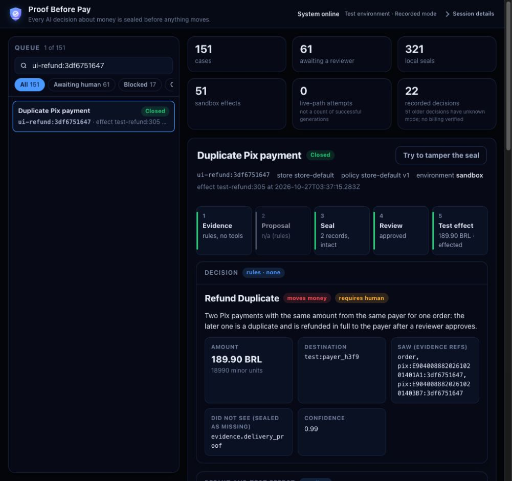

# Proof Before Pay

Seal what an AI agent saw, what was missing and what it decided **before** an action.
The application runs on InterSystems IRIS AI Hub EAP build154: native Interoperability
intake/process/operations, deterministic policy, scoped read-only tools, authenticated
Workflow review, a sealed approval, a single-use permit and one confirmed sandbox effect.
The review console detects edits to decision copies and shows the sealed evidence chain.
Model proposals are also checked against actual tool observations: invented/null references,
inconsistent money flags and missing evidence cannot silently close a case. Unsupported financial
actions go to a person; only duplicate refunds are executable in v1.

Simple cases use deterministic rules without a model call. When no rule matches, the
AI Hub agent reads the five scoped tools and proposes a decision; policy and the context
guard constrain it before sealing. The live integration evidence includes a legacy
`duplicate_charge` case where the agent proposed a refund and authenticated test review
produced one verified sandbox receipt. This establishes integration, not an advantage
over a deterministic solution. The held-out agent benchmark is still pending.

**Status:** the native workflow is tested in recorded mode and with real Gemini, OpenAI
and Anthropic models through OpenRouter in a private synthetic lab. Each model completed
one scenario with five native tool calls, authenticated test review, sealed approval and
one confirmed sandbox effect. This is an integration smoke test, not a model-quality ranking
or evidence for three-agent voting. A reviewer-note defect found during that trial was fixed
and covered by replay regression. Public demo, held-out benchmark, video and final submission
remain pending. No bank settlement or independent external anchor is claimed. See
[application design](docs/README-APP.md), [validation](docs/VALIDATION.md), and
[provider experiment](docs/PROVIDERS.md).

Maintainer: [Rafael Orlando Mendes](https://community.intersystems.com/user/rafaelorlando-mendes).
Code developed with AI assistants under Rafael's direction. License: [MIT](LICENSE).
The vendor EAP image is separately licensed and is not distributed here.



Private synthetic lab: this case was decided by deterministic rule R1, followed by
authenticated test review. It shows 18990 minor units as 189.90 BRL; it is not a live
model decision or real settlement. The [receipt view](docs/screens/native-refund-receipt.png)
shows the consumed permit and intact historical receipt. A separate
[guard-refusal screen](docs/screens/native-ui25.png) illustrates nonfinancial escalation.
The [live agent-to-refund evidence](docs/validation/gemini-direct-smoke.json) is a different,
one-scenario integration test. None of these is a public demo or the held-out benchmark.

## Start the isolated IRIS lab

Prerequisites: Docker Engine with Compose v2; x86-64 Linux (tested); enough capacity
for the approximately 6.8 GB unpacked vendor image, its archive/build overhead and 1.2 GiB of container RAM.
The tested lab had at least 2.5 GB free **after** the base image had already been loaded.

1. Obtain the **AI Hub Community build 154** archive from the
   [official EAP portal](https://evaluation.intersystems.com/EAP/), completing the
   vendor's access and license steps yourself. Use the x64 archive
   `iris-community-2026.3.0AI.154.0-docker.tar.gz`. The
   [contest instructions](https://community.intersystems.com/post/intersystems-programming-contest-ai-agents-interoperability-workflows)
   specify build 154. The downloaded image and any derived image must stay private.
2. Load the archive locally and tag the loaded image:

   ```sh
   docker load --input /path/to/iris-community-2026.3.0AI.154.0-docker.tar.gz
   docker tag docker.iscinternal.com/docker-intersystems/intersystems/iris-community:2026.3.0AI.154.0 proof-before-pay/iris-eap:2026.3.0AI.154.0
   ```

   The validated x64 image ID is
   `sha256:8fc1e5c64ed790aa263af05089d003a49bba272fb9c714e4823dd868aebff2a6`.
   The archive's SHA-256 was
   `8b0daa63f279ef9f11fd2377ab9fcf5d5cc953e8141d000539d7eecceee39170`.
   Check your archive/image against those values for the same x64 kit.
3. From this repository:

   ```sh
   docker compose up --build --detach --wait
   python3 scripts/test_iris.py
   python3 scripts/test_ledger.py
   python3 scripts/test_workflow.py
   ```

   Startup compiles the application recursively, loads synthetic policies/replay fixtures,
   installs reviewer permissions and starts the native Production. The health gate waits
   for installation as well as IRIS. Tests cover the real embedded-Python bridge, journaled
   ledger and concurrent sessions, native unit suites and the complete recorded workflow.
   A missing marker or failed assertion is a failure even if the IRIS terminal exits zero.
4. Stop with `docker compose stop`. `docker compose down` removes the container but
   preserves the named `iris-state` volume. Restart and recreation retain cases, approvals
   and receipts. `docker compose down --volumes` deliberately erases this lab data.

The service has no network, published port, wallet, model credential or paid inference.
Its working directory and IRIS databases must be writable. It uses the vendor's
normal startup capabilities, dropping NET_RAW and MKNOD. The installer creates the `PBPReview` resource and `PBPReviewer` role and grants it
to existing users listed in `PBP_REVIEWERS` (default: the installing OS identity,
`_SYSTEM,SuperUser,Admin`). It creates no password or default public reviewer login.
Only explicitly trusted reviewers should be listed. Do not expose this lab publicly.

Apple Silicon is not validated. An ARM64 EAP kit is available from the vendor;
using it requires the matching local image and `IRIS_PLATFORM=linux/arm64`.
Do not compare that image with the x64 hash above.

## Private review console

The default lab has no network. To opt into an authenticated console with a loopback-only
published port and normal bridge networking:

```sh
docker compose -f compose.yml -f compose.ui.yml up --build --detach --wait
```

Open `http://127.0.0.1:52773/pbp/ui/` with an existing IRIS login that has the reviewer role
and normal application/database access. No model key is loaded by this profile. Password
setup belongs to your private IRIS instance; do not publish vendor default credentials.
The reviewer role includes SELECT on the synthetic projections and native Workflow task
lookup. The authenticated session, rather than a JSON operator field, supplies identity.

Feed the ten synthetic cases using the native runtime tests or `pbp.Setup.FeedCases()`.
For an HTTP gate on this loopback URL set `PBP_TEST_BASE_URL`, `PBP_TEST_USER` and
`PBP_TEST_PASSWORD` privately, then run `python3 tests/http_workflow.py`. These tests
perform only synthetic sandbox effects. They require recorded mode and reject a public URL.

For explicitly authorized real inference, populate ignored `private/providers.env` and
add `-f compose.live.yml`. That profile enables outbound networking and loads credentials;
it is an intentional cost-bearing opt-in. Always specify the provider and model. See
[provider scope and comparison](docs/PROVIDERS.md). Never put keys in a Compose argument,
a command line, Git, a screenshot or a public image.

## Test the language components

```sh
cd seal
npm ci
npm test
npm run typecheck
cd ..
python3 -m venv .venv
. .venv/bin/activate
python -m pip install --require-hashes -r requirements.lock
python -m pip install -r requirements-test.txt
python -I -B tests/offline_runner.py
python -m pytest -q python/tests
python scripts/check_source.py
```

GitHub Actions runs the TypeScript vectors/typecheck and Python suites. The vendor
EAP image is not available on public CI runners, so actual IRIS compile/bridge tests
run with `scripts/test_iris.py` in the local private-image lab. A green public workflow
alone does not establish an IRIS integration pass.

## What is sealed

The salted SHA-256 commitment covers canonical JSON: inputs, tool outputs, explicit
missing evidence, policy, forbidden actions, decision and autonomy limits. An edited
decision or a dossier completed after sealing changes the commitment. The adapter
rejects personal data and bounded-input errors without returning offending values.
`Witness.Seal` creates a local commitment; `Witness.VerifyLocal` detects edits.
An intact local envelope stays `pending` until independent anchoring is verified.
This is an application-level integrity check against the stored commitment. A privileged
administrator who can replace the record, salt and commitment can rewrite local history;
protection from a compromised host or database administrator is not claimed. A rejected
model proposal remains a separately labelled, unsealed diagnostic; the effective escalation
and its input/tool evidence are sealed.

The validated agent operation uses one worker. Its current-case binding is held in a
process-private global, enforced by both the authorization policy and the tools, and cleared
after each run. Increasing parallelism requires separate validation; one-worker results are
not a scalability claim.

The original `pbp_seal` reference also contains chain and Solana helpers. Those are
not invoked by the runtime or tests, which do not sign or broadcast transactions.
The historical S0 fixture is public synthetic test evidence, not a new S1 anchor.

See [provenance](docs/PROVENANCE.json), [runtime diagnosis](docs/IRIS-154.md),
[validation](docs/VALIDATION.md), and the [submission draft](docs/OPEN-EXCHANGE.md).
The [contest bonus tracker](docs/BONUS-TRACKER.json) now maps the official contest49
table to implementation evidence and pending deliverables. Published point values are not
points awarded to this application.
