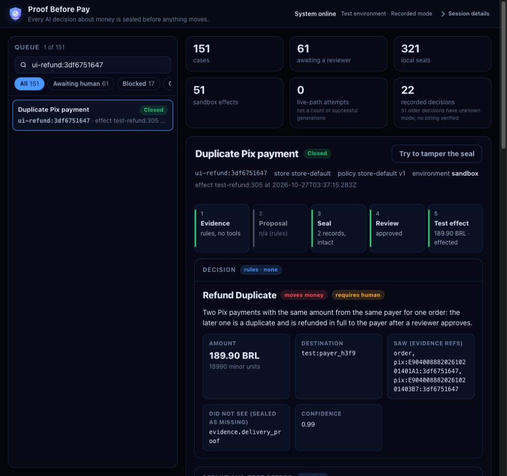

# Proof Before Pay

[Open Exchange](https://openexchange.intersystems.com/package/Proof-Before-Pay) ·
[Video 4.2.1 with captions](https://www.youtube.com/watch?v=LX_0V4C6wLw) ·
[Download MP4](https://github.com/rafaorlando3/proof-before-pay/releases/download/media-v4.2.1/Proof-Before-Pay-en.mp4) ·
[Developer Community article 5.3](https://community.intersystems.com/post/proof-pay-testing-payment-proposals-inside-intersystems-iris-ai-hub) ·
[Artigo em português](https://pt.community.intersystems.com/post/proof-pay-testando-propostas-de-pagamento-no-intersystems-iris-ai-hub)

Seal what an AI agent saw, what was missing and what it decided **before** an action.
The application runs on InterSystems IRIS AI Hub EAP build 154: native Interoperability
intake/process/operations, deterministic policy, scoped read-only tools, authenticated
Workflow review, a sealed approval, a single-use permit and one confirmed sandbox effect.
The review console detects edits to decision copies and shows the sealed evidence chain.
Model proposals are also checked against actual tool observations: invented/null references,
inconsistent money flags and missing evidence cannot silently close a case. Unsupported financial
actions go to a person; only duplicate refunds are executable in v1.

Simple cases use deterministic rules without a model call. When no rule matches, the
AI Hub agent reads the five scoped tools and proposes a decision; policy and the context
guard constrain it before sealing.

## Start here: judge quick path

Open the [hosted review console](https://review.pbp49.78-17-93-244.sslip.io/pbp/ui/) with the dedicated viewer credentials supplied through the contest organizer. No Docker, IRIS installation, API key or wallet is needed. These are viewer credentials, separate from your Open Exchange or IRIS login; the sign-in page explains how to request an invitation.

1. **Completed sandbox refund:** use the first “Start with the proof” button. Follow the recorded proposal, sealed human approval, consumed single-use permit and intact synthetic receipt.
2. **Retained LIVE decision:** use the second button for session1566. Inspect the actual tool outputs and cited local policy in **Time Machine**, then the intact decision seal. Its outcome is human review, with no permit, receipt or financial effect.
3. **Constructed missing-evidence input:** use the third button to compare a refused `accept_order` proposal with the effective sealed escalation. This is a labelled synthetic fixture, not a successful model run.
4. **Check the boundary:** “Try to tamper” verifies an edited copy without changing the original. This viewer cannot approve payments. Opening any retained example makes no model call.

Fresh LIVE requests are optional and explicitly labelled; their current health, quota and cumulative US$5 budget gates appear in the console. The retained route remains useful without a fresh request. See the [full judge path](#judge-path) for details and limitations.

For a deeper inspection, the **Proof desk** offers Cases, Dossier, Evidence, Timeline, Seals and Evaluation navigation, Paper/Ink appearance, a searchable, filterable retained-case catalogue and an interactive proof journey. A guided Previous/Next inspection separates the diagnostic proposal, verified decision, actual review and synthetic effect. The dossier shows readable sealed inputs and gaps, visible trace sessions and retained vector-policy passages; raw JSON and historical event text remain available. Evaluation includes the published v7 case outcomes and limitations without rerunning them. The [scenario and test guide](docs/JUDGE-SCENARIOS.md) explains each online outcome, the ten separate public local fixtures, copy verification, reproduction commands and the limits of those evaluations. The hosted catalogue has ten allowlisted recorded examples plus a window of up to five completed LIVE records; the verified baseline is **11 examples**, including session1566. That count can change with legitimate LIVE use. Three inputs are explicitly labelled constructed. Opening records makes no model call, and the expanded historical catalogue grants no extra LIVE requests or approval rights.

A five-item **Local inspection checklist** helps a juror follow the evidence, proposal, seal, review and effect in each loaded case. Progress, filters and search are saved only in that browser. **Next available case →** follows the current filter; **Clear local marks** clears only the current case. Completion is a navigation aid, not a score, correctness result, submitted review or payment approval.

Selecting a retained case automatically starts the inline **AI activity** replay: the existing workflow steps highlight as recorded tools, proposal, seal, review and outcome are revealed. Pause, step controls and presentation speed remain available; reduced-motion preference disables autoplay. This illustrates stored records, not a fresh execution, private model reasoning or measured latency. Background refresh does not restart playback.



Private synthetic lab: this case was decided by deterministic rule R1, followed by
authenticated test review. It shows 18990 minor units as 189.90 BRL; it is not a live
model decision or real settlement. The [receipt view](docs/screens/native-refund-receipt.png)
shows the consumed permit and intact historical receipt. A separate
[guard-refusal screen](docs/screens/native-ui25.png) illustrates nonfinancial escalation.
The [live agent-to-refund evidence](docs/validation/gemini-direct-smoke.json) is a different,
one-scenario integration test. None of these screenshots is the public viewer or the independent v5 cohort.

<details>
<summary>Hosted LIVE qualification, historical failures and budget scope</summary>

Published on 3 November 2026. [Contest49 registration is publicly listed](https://openexchange.intersystems.com/contest/49); the package review badge remains separate. The video predates the v7 evaluation. The authenticated online viewer serves retained examples from a running IRIS instance. The dedicated route produced its first valid cited LIVE decision on 5 November; fresh-request availability is shown inline and requires the existing health, quota and budget gates. Reading retained cases makes no model call.

The optional fixed-scenario LIVE path uses native actors, a private budget bridge, a persistent queue and inline status. [Session1566 qualified on the VPS](docs/validation/live-gemini35lite-1566-20261105.json): Gemini3.5Flash-Lite, medium reasoning and a4096 output bound completed three normal tool/decision HTTP turns without retry or JSON repair. Five real tools included local policy retrieval; the valid human-review proposal cites an observed passage inside its intact seal. Six native message headers connect Intake, Process, Agent, Witness and Workflow. No permit, receipt or financial effect was created. [Earlier timeouts,503s and refused truncation](docs/validation/live-output4096-20261105.json) remain historical failures. The six uncertain reservations remain intact under the expressly approved cumulative US$5 ceiling. Token estimates and reservations are not billing receipts; this one case establishes no general quality advantage. [Operator controls](demo_gateway/LIVE-DEMO-PLAN.md).

</details>

## Audited v7 result, 1 November 2026

The current release adds the [final v7 report](docs/validation/paired-v7-20261101.md)
and its [structured summary](docs/validation/paired-v7-20261101.json). The older
validation sections below retain their historical scope and failures.

In one pre-frozen informed set of 12 cases (four controls and eight residues),
the agent's raw proposals were correct in **11/12**, versus **7/12** for conservative
rules and **8/12** for the deterministic baseline. The frozen criterion was met:
at least two more correct raw decisions than both baselines, zero unsafe agent
decisions and all four controls correct. Effective results were **10/12**, **7/12**
and **8/12** respectively; correct autonomous closures were 5, 3 and 3. The r4 refund
was safely blocked because its exception label is outside the ledger contract;
its frozen eligible-effect label was an authoring error and remains counted against
the agent. In r8 the agent missed a required missing-evidence declaration. These
errors were not repaired by another run.

Claude independently remapped all 36 records and recomputed the identical score.
The result is descriptive evidence on these cases, not a blind sample, independent
human study, population estimate or general superiority claim. Estimated usage
cost was US$0.02566575, not a billing receipt. All effects were synthetic.

The basic authenticated viewer journey was checked through automated browser
navigation with Rafael signing in manually, including three cases, a tampered and
restored record copy, and queue access at 303/390/980/1100 pixels. Logout and recovery
code consumption were not run. Installation remained qualified on the owner's
already loaded licensed build154 amd64 image under emulation on Apple Silicon,
not a fresh portal download or independent human install. The video 4.2.1 and
selected replay examples predate v7 and are not footage of that run. See the
[article 5.3](docs/ARTICLE-5.3.md) for the development history and limitations.

## What to inspect first

Use the [judge path](#judge-path) below to inspect these examples. Recorded proposals are replay,
not new inference; a proposed money flag is not a completed effect.

| Example | What it demonstrates | Where to inspect |
| --- | --- | --- |
| Completed synthetic refund | A recorded agent route, authenticated test review, exact sealed approval, single-use permit and intact receipt. | The viewer's selected completed example; [historical recorded integration](docs/validation/native-recorded-demo42.json). |
| `pix-0006` | R1 to R3 abstain. The recorded tape names the missing carrier signature despite a delivery scan. No money is proposed, so this route does not call `Ledger.Stage`. | Local public fixture; [recorded proposal](fixtures/replay/decisions.json) and [context guard](python/pbp_guard/decision.py). The UI explains the roles when its retained decision seal verifies intact. |
| `pix-0008` / `adversarial:*` | An unsupported withdrawal proposal, invented evidence or inconsistent flags are refused; the effective decision is a sealed escalation. | Local recorded fixtures or cases generated by `test_workflow.py`; [adversarial harness](tests/iris/adversarial_smoke.py). Raw proposals are diagnostic, not authority. |
| Contained live proposal | A malformed amount was misread by the model; the server refused the refund target and no effect occurred. | [Historical v5 report](docs/validation/live-independent-v5.json), also explained in the console. This is not a new inference or a quality estimate. |

The store policy lists possible business requests; the v1 execution contract is narrower. Full or
partial refunds and withdrawal retries are not executable merely because they appear in that list.
They escalate rather than widening the contract. See [the guard](python/pbp_guard/decision.py) and
[the synthetic ledger contract](python/pbp_ledger/contract.py).

## What this adds

Our contribution is a set of properties that hold together inside one native IRIS production, each
one checked by the validation evidence linked below:

1. What the agent did **not** see is sealed as missing, as a first-class field of the record. Completing the record
   afterwards changes its commitment; the reviewer reads the gaps before the proposal. This is a local
   integrity check with the privileged-rewrite limit described below.
2. The model never chooses where the money goes or which payment is returned. The destination is the
   store's own record for the order and the refund target is derived on the server from the observed
   payments; the customer message, nested order destination fields and model prose do not override that stored
   test binding. This does not authenticate the original case data or a real bank destination. See
   [recipient binding](docs/validation/recipient-observability-fix.json) and the
   [independent cohort](docs/validation/live-independent-v5.json).
3. One sealed approval binds one single-use permit, which produces at most one test effect; a second
   attempt with the same permit is refused, also under concurrent sessions.
4. Model decisions retain their actual tool outputs; rule decisions retain the inputs they read.
   The native Production messages carry the commitment, and the console reconstructs the retained evidence
   for inspection. Forensic replay does not rerun a model or guarantee the same future model response.
5. The failures are published with their fixes: a policy miss in the baseline, an observability gap that
   failed a whole round, and a raw proposal on a malformed amount that the server contained.

Related work includes Google's [Agent Payments Protocol (AP2)](https://github.com/google-agentic-commerce/AP2);
we do not claim to have invented proof-before-payment. The combination above, executed natively on IRIS with explicit ignorance
and published failures, is what we submit for review.

<details>
<summary>Earlier validation rounds and installation qualifications</summary>

**Status:** the native workflow is tested in recorded mode and with real Gemini, OpenAI
and Anthropic models through OpenRouter in a private synthetic lab. Each model completed
one scenario with five native tool calls, authenticated test review, sealed approval and
one confirmed sandbox effect. This is an integration smoke test, not a model-quality ranking
or evidence for three-agent voting. A reviewer-note defect found during that trial was fixed
and covered by replay regression. Isolated cold installation, lifecycle and native IPM application
load/uninstall/local-package tests passed; [scope and qualifications](docs/validation/native-installation-IPM.json)
include the separate [fresh-volume IPM bootstrap result and limitations](docs/validation/native-IPM-bootstrap.json).
The [31 October reproduction](docs/validation/independent-reproduction-A-20261031.md)
adds a qualified untraced USER IPM bootstrap, source-only package lifecycle and
scripted judge HTTP journey, cross-reviewed against the retained evidence. It used
the owner's licensed cached build154 image under amd64 emulation on Apple Silicon;
it is not an independent human or authenticated browser-DOM walkthrough.
A final independent eight-case cohort was accepted on 28 October with one raw model failure contained by the
server (see the validation summary). The later twelve-case paired trial retains its
failed first-attempt instrumentation score alongside a separately admitted,
post-hoc technical repeat on the same known cases. That repeat observed three
autonomous residue closures for both G and deterministic triage D, so the required
autonomy gain was not demonstrated. Claude independently recomputed both scores byte for byte in C1236. G and D
closed different sets of three cases; the selected free-text failures were authored
with knowledge of D's lexicon. See [both readings and their limits](docs/validation/paired-v6-20261031.json)
and the [final descriptive report](docs/validation/paired-v6-report-B.md).
The recorded video predates both cohorts. Dedicated reviewer access is supplied
privately; the reviewed r6 source and media are published; contest49 registration is publicly listed. No bank settlement or independent
external anchor is claimed; local seals detect edits to a copy and do not protect against an administrator who
can rewrite the database. Independent external custody remains a roadmap item without a date;
the separately qualified optional Solana devnet Memo extension is described below. See [application design](docs/README-APP.md), [validation](docs/VALIDATION.md), and
[provider experiment](docs/PROVIDERS.md).

## Validation summary

The live integration evidence includes a legacy
`duplicate_charge` case where the agent proposed a refund and authenticated test review
produced one verified sandbox receipt. This establishes integration, not an advantage
over a deterministic solution. A later ten-case live challenge failed all four mandatory
financial positives: the agent could not observe the stored refund destination.
The tools now expose that case-bound value explicitly. The subsequent frozen live run
passed 14 protected outcomes: six mandatory positives each produced one intact synthetic
receipt, and eight negatives produced zero effects. Ten cases were post-fix regressions
and four were prospective controls. One raw proposal was still incorrect and was contained
by the core; this is not a claim of 14 correct model proposals or population-level accuracy.
Claude independently recomputed the results, and all ten supplied historical reviewer JSON
reports match our parsed originals. [The failed result](docs/validation/live-v3-failed.json),
[post-fix scope](docs/validation/live-v4-regression-controls.json), and
[independent review](docs/validation/independent-v4-review.json) are retained together.

A final independent eight-case cohort (new trap types, written by the reviewer after all earlier results
were known, frozen and cross-checked by hash before any output) completed on 28 October: the three
mandatory financial positives each produced one intact synthetic receipt to the stored destination; the
five negatives produced no effect and remain pending for a person. One raw proposal was wrong: the model
reinterpreted a malformed order amount ("189.90") as minor units and proposed a refund; the server-side
target derivation refused it and the sealed decision was an escalation with the refund target marked
missing. This is an informed adversarial set, not a blind sample or a population estimate; it establishes
nothing beyond these eight cases. See [the independent cohort](docs/validation/live-independent-v5.json)
and [its cross-review](docs/validation/independent-v5-review.json).

Maintainer: [Rafael Orlando Mendes](https://community.intersystems.com/user/rafaelorlando-mendes).
Code developed with AI assistants under Rafael's direction. License: [MIT](LICENSE).
The vendor EAP image is separately licensed and is not distributed here.

</details>

## Judge path

Two paths exist with the prerequisites below. Times are not promised because the vendor image download,
license steps and an independent new-operator walkthrough were not measured.

**Path A, no installation: the authenticated judge viewer.** Open
[the dedicated judge viewer](https://review.pbp49.78-17-93-244.sslip.io/pbp/ui/).
No Docker, IRIS account, provider key or wallet is needed for this hosted path.

1. Use the application's sign-in form with the **Viewer name** and **Access password**
   supplied privately for this viewer. These are separate from your Open Exchange,
   Developer Community and local IRIS credentials. If the invitation did not include
   them, ask the contest organizers or [the project owner](https://community.intersystems.com/user/rafaelorlando-mendes)
   for the dedicated demo access; do not post passwords in public comments.
2. Inspect a retained example first. The completed synthetic refund shows evidence,
   sealed approval, a single-use permit and a test receipt. The retained LIVE case
   `public-live:lite35_f3ac72b4c4b9412b9d664e0f73e38ebe` (session **1566**)
   shows five real tools, retrieved policy passages, a cited chunk and an intact
   human-review decision, with no permit, receipt or payment effect. Opening these
   records makes **no model call**.
3. **Try to tamper** edits only your displayed copy: verification becomes tampered;
   restoring the copy makes it intact. The stored record is unchanged. This viewer
   cannot approve payments or submit arbitrary cases.
4. A fresh request is optional. In **Try live**, read the current inline availability
   and remaining allowance before using **Run a fresh decision**. Only two fixed
   synthetic scenarios are admitted, subject to service health, provider capacity,
   daily quotas and the preserved cumulative US$5 ceiling. It was explicitly enabled
   on 5 November; availability can change. If unavailable or a request fails, inspect
   the retained case instead; do not resubmit an uncertain request. The authenticated
   completed-case list links back to the retained result.

The [valid LIVE qualification](docs/validation/live-gemini35lite-1566-20261105.json)
and [explicit bounded public enable](docs/validation/live-bounded-public-enabled-20261105.json)
record their exact scopes. The video and older delivery-conflict example remain
historical recorded demonstrations. **Lost your access details?** opens recovery,
which needs an owner-issued single-use code valid for 15 minutes; it does not create
an account or change a password. Access is private; an available login page does not
by itself establish that every judge received the invitation.

**Path B, private execution in recorded mode (no model key or paid inference).** Requires the AI Hub
EAP build154 image from the vendor portal and the local-image setup described below. The default Compose
profile has no network; the optional console profile enables normal bridge networking and binds its
HTTP port only to loopback. The public viewer and this private IRIS authentication are separate.

1. Load and tag the vendor image as described under "Start the isolated IRIS lab", then run:

   ```sh
   docker compose up --build --detach --wait
   python3 scripts/test_iris.py
   python3 scripts/test_workflow.py
   python3 scripts/test_recipient.py
   ```

   The first test checks the actual compile/smoke markers and prints `"compile_ok": true` and `"ok": true`.
   The workflow test prints `"ok": true` with its measured native unit/E2E/adversarial counts; an IRIS
   session exiting zero alone is not enough. These tests use authenticated automated synthetic review,
   not a claim that the person running the command manually approved each case. Recipient tests cover
   one known-destination positive and absent/mismatched-destination zero-effect alternatives in recorded
   mode. Projection fixtures are rolled back; the recorded workflow cases remain in the private test lab.
   The workflow test creates unique suffixed case IDs, reported in its JSON result; use those IDs in the
   console. Search for `adversarial:` to inspect its three recorded proposals refused by the guard.
   `FeedCases()` alone feeds the original ten public fixtures; it does not create those adversarial cases.
2. To exercise the HTTP workflow, opt into the private console profile:

   ```sh
   docker compose -f compose.yml -f compose.ui.yml up --build --detach --wait
   ```

   Privately configure `PBP_TEST_BASE_URL=http://127.0.0.1:52773` and `PBP_TEST_USER`/`PBP_TEST_PASSWORD`.
   The HTTP test appends `/pbp/api` itself; do not include that suffix in the base URL. Use an existing
   private IRIS test login whose name begins with `PBP`, with the reviewer role and normal application
   access; no reviewer password is shipped. Run `python3 tests/http_workflow.py` to exercise authenticated
   review, one intact receipt, consumed permit, copy verification and refused/stale approval requests.
   This command reviews its own generated case automatically and performs synthetic effects only.
3. If you need a **new unreviewed** case for an independently configured private console, use the same
   private environment and run `python3 tests/http_workflow.py --seed`. This only creates a fresh case and
   prints its id/commitment. It clones `pix-0001` with unique payment references: a deterministic
   `duplicate_payment`/R1 case, not a live or recorded agent decision. Do not expect a case already closed
   by the full HTTP test to be approvable again. The raw local IRIS console uses the instance's own access
   mechanism; the modern browser demonstration is Path A, which has no approval rights.
4. To populate the ten public synthetic fixtures, run `Do ##class(pbp.Setup).FeedCases()` in a USER IRIS
   terminal. Installation and the bridge smoke alone do not feed them. `pix-0009` has no stored destination:
   inspect its missing refund target and zero effect. `pix-0005` is an `amount_mismatch` with a recorded agent
   proposal and five retained tool outputs; it escalates without money. These are public fixtures, not
   the private live benchmark. Repeated fixture ingestion is not a new benchmark or new approval.


Live inference (a real model deciding a duplicate charge that moves test money) needs your own provider key
and the `compose.live.yml` profile described below; it is a cost-bearing opt-in and is not part of this path.

## IPM installation option

**Current package: `0.1.0-beta.4`, 47 class resources and seven native Python packages.**
Use a **dedicated build154 instance with functioning IPM**, then follow the
[operator guide](IPM-OPERATOR.txt). The vendor image and SDK are obtained separately.
Installation starts no Production and enables neither LIVE nor policy retrieval.
The optional Java PEX component uses its [separate source-checkout recipe](pex/README.md).

The [exact public beta.4 archive](docs/validation/IPM-beta4-public-artifact-20261105.json)
was installed natively **offline in an initialized isolated lab**: 296 distributed
files matched Git9b2ee09, with all 47 class sources, seven imports and 34 installed
assets qualified. This is a host download followed by native offline IPM load,
**not** a fresh vendor bootstrap or a native public-registry network fetch for beta.4.
The [native beta.4 qualification](docs/validation/IPM-beta4-native-20261105.json)
and earlier installation evidence below retain their separate scopes.

<details>
<summary>Historical beta.1 and earlier bootstrap/lifecycle evidence</summary>

The [public-registry installation](docs/validation/public-IPM-20261103.json) passed on 3 November 2026:
`zpm "install proof-before-pay"` downloaded version `0.1.0-beta.1` from the public
community registry, compiled all 38 resources and imported all six native Python packages.
This used an isolated copy of an initialized IPM lab, not a new vendor bootstrap;
Production remained stopped and no new cases or model calls were made.

The repository includes `module.xml` and the hash-pinned `requirements.txt`. Use a
**dedicated build154 instance with a functioning IPM installation**; the vendor
image and SDK are obtained separately. Follow [the operator guide](IPM-OPERATOR.txt).
Configure installs the application with Production stopped. The historical native module used
six Python packages and per-app manager asset directories; the optional legacy
Solana library is outside this module. The [native acceptance record](docs/validation/native-installation-IPM.json)
covers loaded classes, 48 recorded workflow checks, package generation, uninstall,
local archive reinstall and the original receipt in both SQL and the authoritative Ledger.
This is a local installation test, not a published registry release or a new model benchmark.
The [31 October independent follow-up](docs/validation/independent-IPM-20261031.json)
adds an untraced USER bootstrap on a fresh plain-vendor volume, all 38 declared
resources, 48 recorded checks, and package/uninstall/local-reinstall receipt continuity.
It ran under x64 emulation on Apple Silicon; the failed namespace and readiness
attempts remain recorded; the qualified final report separately records Claude's review of the supplemental repair evidence.

</details>

## Start the isolated IRIS lab

Prerequisites: Docker Engine with Compose v2; Python 3 on the host for the `scripts/test_*.py`
commands; x86-64 Linux (tested); enough capacity
for the approximately 6.8 GB unpacked vendor image, its archive/build overhead and 2 GiB of container RAM,
plus memory for Docker and the host. The independent run used a 3 GiB Docker daemon allocation.
The tested lab had at least 2.5 GB free **after** the base image had already been loaded.
The earlier 1.2 GiB container limit allowed worker OOM kills during the independent
recorded workflow run under amd64 emulation on Apple Silicon. The recorded tests and authenticated HTTP workflow subsequently
passed with a 2 GiB limit; the container supervisor alone had not detected the worker failure.
In a later cold boot under emulation, compilation and installation finished about three
minutes after container start. The default health grace period is 180 seconds; it still
reports healthy as soon as initialization and the checks succeed. The earlier shorter
grace produced a failed first `compose up --wait` followed by natural recovery in the
same container. That failed attempt is retained; no restart or health reset was used.

1. Obtain the **AI Hub Community build 154** archive from the
   [official EAP portal](https://evaluation.intersystems.com/EAP/), completing the
   vendor's access and license steps yourself. Use the x64 archive
   `iris-community-2026.3.0AI.154.0-docker.tar.gz`. The
   [contest instructions](https://community.intersystems.com/post/intersystems-programming-contest-ai-agents-interoperability-workflows)
   specify build 154. The downloaded image and any derived image must stay private.
2. Load the archive locally and tag the loaded image:

   ```sh
   docker load --input /path/to/iris-community-2026.3.0AI.154.0-docker.tar.gz
   docker tag docker.iscinternal.com/docker-intersystems/intersystems/iris-community:2026.3.0AI.154.0 proof-before-pay/iris-eap:2026.3.0AI.154.0
   ```

   If build154 is already loaded under another local alias, Compose accepts it without an extra retag:
   `IRIS_IMAGE=iris-community:2026.3.0AI.154.0 docker compose up --build --detach --wait`.

   Inspect the loaded image before building:

   ```sh
   docker image inspect --format 'id={{.Id}} arch={{.Architecture}} os={{.Os}}' proof-before-pay/iris-eap:2026.3.0AI.154.0
   ```

   The validated x64 image has OCI manifest digest
   `sha256:8fc1e5c64ed790aa263af05089d003a49bba272fb9c714e4823dd868aebff2a6`
   and image configuration digest
   `sha256:1d3d52bf15f4f69efb7b5d5e857382099694817132ed00aa989aa158adcedf74`.
   Docker's classic image store reports the configuration digest as `.Id`; the containerd
   image store used in our earlier lab reported the manifest digest. Both identify the
   verified image chain; a different store's `.Id` alone does not imply different image contents.
   The original vendor archive used in the lab had SHA-256
   `8b0daa63f279ef9f11fd2377ab9fcf5d5cc953e8141d000539d7eecceee39170`.
   That archive hash applies to the original x64 kit, not to a private `docker save` re-export.
   The image must report `arch=amd64 os=linux`; keep the vendor archive and image private.
3. From this repository:

   ```sh
   docker compose up --build --detach --wait
   python3 scripts/test_iris.py
   python3 scripts/test_ledger.py
   python3 scripts/test_workflow.py
   python3 scripts/test_pairguard.py
   python3 scripts/test_recipient.py
   ```

   Startup compiles the application recursively, loads synthetic policies/replay fixtures,
   installs reviewer permissions and starts the native Production. The health gate waits
   for installation as well as IRIS. Tests cover the real embedded-Python bridge, journaled
   ledger and concurrent sessions, native unit suites and the complete recorded workflow.
   The pairguard gate also races opposite refund targets and verifies that the rule and
   recorded-agent routes cannot refund both members of the same observed payment pair.
   A missing marker or failed assertion is a failure even if the IRIS terminal exits zero.
   Where the runtime exposes an `oom_kill` counter for this process's own cgroup,
   readiness also fails
   after a kernel OOM kill in this container, even if the IRIS supervisor is still alive.
   This counter survives a worker's death until the container is recreated; it does not
   identify the killed job. The helper checks the private v2 cgroup namespace or resolves
   the exact v1 self path, so a host/root counter cannot attribute another container's
   OOM to this one. Coverage is established for v2 with a private cgroup namespace.
   On v1, a mount rooted at the container's own cgroup may hide that self path; the
   check then reports unavailable rather than using an ambiguous root counter.
   Missing namespaces or older v1 counters are also reported as unavailable;
   the normal boot/IRIS checks still apply in those cases.
   Health status does not establish that every Production worker or the full workflow is
   functioning: the recorded workflow tests above provide that separate evidence.
4. Stop with `docker compose stop`. `docker compose down` removes the container but
   preserves the named `iris-state` volume. Restart and recreation retain cases, approvals
   and receipts. `docker compose down --volumes` deliberately erases this lab data.

The service has no network, published port, wallet, model credential or paid inference.
Its working directory and IRIS databases must be writable. It uses the vendor's
normal startup capabilities, dropping NET_RAW and MKNOD. The installer creates the `PBPReview` resource and `PBPReviewer` role and grants it
to existing users listed in `PBP_REVIEWERS` (default: the installing OS identity,
`_SYSTEM,SuperUser,Admin`). It creates no password or default public reviewer login.
Only explicitly trusted reviewers should be listed. Do not expose this lab publicly.

The x64 container was also exercised under emulation on Apple Silicon with the resource
allocation above. A native ARM64 installation is not validated. An ARM64 EAP kit is available from the vendor;
using it requires the matching local image and `IRIS_PLATFORM=linux/arm64`.
Do not compare that image with the x64 hash above.

## Private review console

The default lab has no network. To opt into an authenticated console with a loopback-only
published port and normal bridge networking:

```sh
docker compose -f compose.yml -f compose.ui.yml up --build --detach --wait
```

Open `http://127.0.0.1:52773/pbp/ui/` with a private IRIS reviewer login.
On a fresh volume, follow [the reviewer setup recipe](docs/REVIEWER-SETUP.md) first:
the HTTP workflow needs `PBPReviewer`, `%DB_USER`, the specific
`%Service_EmbeddedPython:USE` resource, and membership in native `pbp.Workflow`.
This combination passed the independent authenticated HTTP test; it is not a proof of
minimum permissions for every installation. No model key is loaded by this profile.
Keep the operator-chosen password private; do not publish vendor default credentials.
The reviewer role includes SELECT on the synthetic projections and native Workflow task
lookup. The authenticated session, rather than a JSON operator field, supplies identity.

Feed the ten synthetic cases using the native runtime tests or `pbp.Setup.FeedCases()`.
For an HTTP gate on this loopback URL set `PBP_TEST_BASE_URL`, `PBP_TEST_USER` and
`PBP_TEST_PASSWORD` privately, then run `python3 tests/http_workflow.py`. These tests
perform only synthetic sandbox effects. They require recorded mode and reject a public URL.

For explicitly authorized real inference, populate ignored `private/providers.env` and
add `-f compose.live.yml`. That profile enables outbound networking and loads credentials;
it is an intentional cost-bearing opt-in. Always specify the provider and model. See
[provider scope and comparison](docs/PROVIDERS.md). Never put keys in a Compose argument,
a command line, Git, a screenshot or a public image.

## Test the language components

```sh
cd seal
npm ci
npm test
npm run typecheck
cd ..
python3 -m venv .venv
. .venv/bin/activate
python -m pip install --require-hashes -r requirements.lock
python -m pip install -r requirements-test.txt
python -I -B tests/offline_runner.py
python -m pytest -q python/tests
python scripts/check_source.py
```

GitHub Actions runs the TypeScript vectors/typecheck and Python suites. The vendor
EAP image is not available on public CI runners, so actual IRIS compile/bridge tests
run with `scripts/test_iris.py` in the local private-image lab. A green public workflow
alone does not establish an IRIS integration pass.

## What is sealed

The salted SHA-256 commitment covers canonical JSON: inputs, tool outputs, explicit
missing evidence, policy, forbidden actions, decision and autonomy limits. An edited
decision or a dossier completed after sealing changes the commitment. The adapter
rejects personal data and bounded-input errors without returning offending values.
`Witness.Seal` creates a local commitment; `Witness.VerifyLocal` detects edits.
An intact local envelope stays `pending` until independent anchoring is verified.
This is an application-level integrity check against the stored commitment. A privileged
administrator who can replace the record, salt and commitment can rewrite local history;
protection from a compromised host or database administrator is not claimed. A rejected
model proposal remains a separately labelled, unsealed diagnostic; the effective escalation
and its input/tool evidence are sealed.

The validated agent operation uses one worker. Its current-case binding is held in a
process-private global, enforced by both the authorization policy and the tools, and cleared
after each run. Increasing parallelism requires separate validation; one-worker results are
not a scalability claim.

The original `pbp_seal` reference contains chain and Solana helpers, separate from
the default local verification path. The default recorded/offline path does not sign
or broadcast transactions. The optional [SolanaMemo extension](#optional-policy-retrieval-and-devnet-anchoring)
was separately qualified with one devnet Memo sent from an Interoperability Production.
It remains disabled without private configuration, creates no transfer and does not
turn local verification into an independent blockchain verifier. The historical S0
fixture is public synthetic evidence, not a new S1 anchor.

See [provenance](docs/PROVENANCE.json), [runtime diagnosis](docs/IRIS-154.md),
[validation](docs/VALIDATION.md), and the [submission draft](docs/OPEN-EXCHANGE.md).
The [contest bonus tracker](docs/BONUS-TRACKER.json) now maps the official contest49
table to implementation evidence and pending deliverables. Published point values are not
points awarded to this application.


## Bonuses

These are evidence and submission states against the [official contest49 bonus rules](https://community.intersystems.com/post/technology-bonuses-intersystems-programming-contest-ai-agents-interoperability-workflows), checked on 9 November. Point values are possible bonuses, not awarded points. Thirteen items have delivery or implementation evidence, with caps totalling 29; the remaining caps total 6 (the two vendor-bug categories). This is an evidence inventory, not a confirmed score.

| Item | Points | Evidence and current state |
|---|---:|---|
| Questionnaire | 1 | Submitted on 3 November; [confirmation record](docs/validation/questionnaire-20261103.json). |
| Workflow Engine | 2 | Implemented: [native review](cls/pbp/Review.cls), [Production](cls/pbp/Production.cls), [authenticated workflow evidence](docs/validation/http-workflow.json). |
| Embedded Python | 3 | Implemented: [Witness bridge](cls/ProofBeforePay/Witness.cls), [Ledger bridge](cls/ProofBeforePay/Ledger.cls), [runtime evidence](docs/validation/ledger-runtime.json). |
| Docker | 2 | Implemented: [Dockerfile](Dockerfile), [Compose](compose.yml), [qualified lifecycle evidence](docs/validation/clean-lifecycle.json). The licensed vendor image is obtained separately. |
| Online demo | 2 | [Running IRIS-backed viewer](https://review.pbp49.78-17-93-244.sslip.io/pbp/ui/), authenticated. [First valid cited LIVE case1566](docs/validation/live-gemini35lite-1566-20261105.json): five tools, intact seal, persisted native trace and no effect. Fresh admission requires explicit operator enablement and is bounded by health, quotas and budget; the viewer shows its actual availability inline. Retained viewing makes no model call. No bonus award inferred. |
| ZPM/IPM | 2 | [Module](module.xml), [operator guide](IPM-OPERATOR.txt). [Public beta.2 registry installation](docs/validation/IPM-public-beta2-20261103.json) retained. Current immutable beta.4 has [native qualification](docs/validation/IPM-beta4-native-20261105.json) and [exact public-artifact qualification](docs/validation/IPM-beta4-public-artifact-20261105.json): 47 resources, seven imports and 296 source files from Git9b2ee09. It was installed offline in an initialized isolated lab; no fresh vendor bootstrap or native registry network fetch is claimed for beta.4. Optional PEX uses the separate source-checkout recipe. |
| Community Opportunity idea | 4 | [DPI-I-689](https://ideas.intersystems.com/ideas/DPI-I-689): native LLM pipeline tracing. [Trace recipe](docs/TRACEABILITY.md) includes the separately labelled recorded1494 Visual Trace screenshot. Inspect the [persisted LIVE1566 native headers](docs/validation/live-session1566-native-headers.json) and the [session1566 record](docs/validation/live-gemini35lite-1566-20261105.json) with its actual tool observations. No new LIVE Visual Trace UI screenshot or awarded points claimed. |
| First DC article | 2 | [Article 5.3, published 3 November](https://community.intersystems.com/post/proof-pay-testing-payment-proposals-inside-intersystems-iris-ai-hub). |
| Second article or translation | 1 | [Portuguese translation published 3 November](https://pt.community.intersystems.com/post/proof-pay-testando-propostas-de-pagamento-no-intersystems-iris-ai-hub). |
| Video | 3 | [Published video 4.2.1](https://www.youtube.com/watch?v=LX_0V4C6wLw) and [anonymous MP4 download](https://github.com/rafaorlando3/proof-before-pay/releases/download/media-v4.2.1/Proof-Before-Pay-en.mp4), [delivered to the organizer](https://community.intersystems.com/post/technology-bonuses-intersystems-programming-contest-ai-agents-interoperability-workflows#comment-288538). [Delivery evidence](docs/validation/video-download-delivery-20261107.json). Four caption languages; historical pre-v7/pre-LIVE footage. |
| IRIS Vector Search | 2 | [Native policy KB](cls/pbp/RAG/Policy.cls): `%AI.RAG`, local FastEmbed and IRIS Vector Search. [Session1566](docs/validation/live-gemini35lite-1566-20261105.json) retrieved three verified passages and cited a real chunk in a valid sealed proposal. Full policy constraints remain authoritative; no measured quality gain or awarded bonus claimed. |
| Custom Interoperability adapter | 2 | [Own SolanaMemo outbound adapter](cls/pbp/Adapter/SolanaMemo.cls), [native Operation](cls/pbp/Operation/SolanaMemo.cls), [confirmed devnet-only Interoperability Production test](docs/validation/solana-memo-devnet-20261103.json). One Memo instruction, no transfer; disabled without explicit private configuration. This is an implementation/test claim, not an awarded bonus. |
| PEX | 3 | [Optional Java export inspection](pex/README.md) in a separate native Production: [Seven native service/operation calls, 14 headers and the exact own-code JAR](docs/validation/pex-export-inspection-20261108.json) were qualified on `941e929`. [Twelve standalone algorithm checks and public CI](docs/validation/pex-public-ci-20261109.json) cover the subsequent status fix; no final-source native IRIS rerun is claimed. Checks transport integrity only; no payment, seal or approval authority. Source-checkout extension, separate from hosted viewer and immutable IPM beta.4. |
| AI Hub / Embedded Python bugs | up to 3 each | No qualifying submitted reproducible vendor bug is claimed. |

See the [structured tracker](docs/BONUS-TRACKER.json) for the complete item list. New functionality is documented as delivered only after its behavior is verified.


## Optional policy retrieval and devnet anchoring

The earlier additions were packaged as `0.1.0-beta.2`. [Native source load, package export and archive installation passed](docs/validation/IPM-beta2-native-20261103.json) in an isolated initialized build154 lab: 47 classes, seven embedded-Python imports and 34 installed asset/Python files matching the archive. The guide and optional dependency lock are included; installation starts no Production and leaves LIVE and policy retrieval disabled. [Public registry beta.2 installation also passed](docs/validation/IPM-public-beta2-20261103.json), using `zpm "install proof-before-pay 0.1.0-beta.2"`; all 287 downloaded source files and 34 declared installed assets matched. The public `0.1.0-beta.1` installation proof above covers its original 38 classes and six Python packages; it does not establish installation of these newer components.

The previous source declared `0.1.0-beta.3`, adding explicit native source restoration/rebinding, Gemini3.6 support and the dedicated demo no-repair guard. [The beta.3 delta passed native source load, package export and archive installation](docs/validation/IPM-beta3-native-20261105.json) on an isolated, initialized VPS test copy: 47 classes, seven imports, 34 installed files matching the candidate and ten changed Operation method bodies checked against source. Provider keys were blank, networking was disabled and no inference or blockchain call occurred. The pinned RFC8785 wheel was supplied offline. This is not a new vendor bootstrap or a native public-registry fetch. The older beta.1/beta.2 and r6 evidence remains unchanged. [The public beta.3 registry archive was subsequently fetched on the VPS host and installed natively offline](docs/validation/IPM-beta3-public-artifact-20261105.json): all 292 distributed source files matched commit953d96d. The isolated lab stayed without network or keys; this is distinct from a native IPM network fetch.

The current source declares `0.1.0-beta.4`, updating the optional fixed-scenario profile to the reviewed Gemini3.5Flash-Lite model and new-call estimates. [Native source load, export and archive installation passed](docs/validation/IPM-beta4-native-20261105.json) in the initialized isolated VPS copy:47classes,7imports,34installed assets and15Runtime/dependent method bodies matched, with keys blank/networknone and defaultOFF. [The exact public beta.4 archive was then installed natively offline](docs/validation/IPM-beta4-public-artifact-20261105.json):296distributed files equal Git9b2ee09, with all class sources/module and34declared assets matching the qualified candidate. This is a host download followed by native offline IPM load, not a native network fetch or fresh bootstrap; the older beta.1/beta.2/beta.3 and r6 artifacts remain historical evidence. Installation still starts no Production and enables neither LIVE nor retrieval.

The fixed-scenario demo can supplement `GetStorePolicy` with passages from an AI Hub knowledge base. Local FastEmbed produces 384-dimensional embeddings; `%AI.RAG.VectorStore.IRIS` stores the vectors and `%AI.RAG.KnowledgeBase` performs retrieval. Each policy hash gets a separate table. Every returned passage must match the exact active policy text and its hash. The full allowed actions, forbidden actions and limits are still returned. Retrieval does not change approval or payment policy.

The demo prompt asks for `policy.chunk:<chunk_id>` references to passages it actually relies on. The context guard rejects unobserved, changed or uncited retrieved passages. The decision seal contains both the tool output and the cited references. [Native qualification](docs/validation/policy-rag-native-20261103.json) covers local retrieval, guard binding, sealing and tamper rejection; successful cited LIVE use is now separately established by [session1566](docs/validation/live-gemini35lite-1566-20261105.json). Neither result establishes a measured quality gain.

Indexing is an explicit operator action: `##class(pbp.RAG.Policy).Stage(pol)` for the loaded policy, then `SetEnabled(1)` only after reviewing the proof. Installation does neither. FastEmbed's first use may download its local model; allow cache disk space and qualify on the declared build before activation. A failed retrieval is labelled unavailable and retains the full policy constraints.

The optional `pbp.Operation.SolanaMemo` uses our `pbp.Adapter.SolanaMemo` to publish only `pbp1:<commitment>` to the fixed Solana devnet endpoint. It accepts an already intact local seal and never creates a payment approval or transfer. The private journal records the signed transaction's expected signature before the sole send. An uncertain result is reconciled by that signature with exact Memo readback; it is never re-signed or resent automatically. [Interoperability Production devnet proof](docs/validation/solana-memo-devnet-20261103.json).

This optional anchor can remain pending: a crash after the durable intent but before transmission, an expired blockhash, or an unconfirmed RPC response does not trigger a replacement transaction. The local seal remains independently inspectable.

The module is not added as a running Production host by installation. It needs an explicit enabled flag, private 0600 devnet keypair file and 0700 state directory. Optional amd64 Python dependencies are pinned in [requirements-solana-devnet.lock](requirements-solana-devnet.lock); install them separately with `python3 -m pip install --require-hashes -r requirements-solana-devnet.lock` into the operator's private Python environment. No key, wallet funding, mainnet endpoint or automatic airdrop is shipped. The qualification host was disabled after its single confirmed test. The normal local verifier continues to report local integrity; it does not silently become a blockchain verifier.
