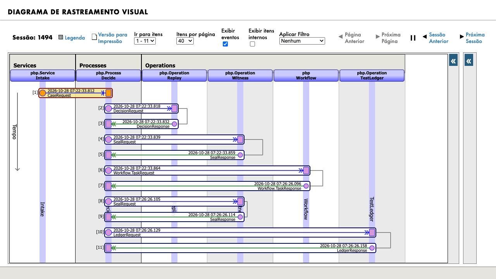
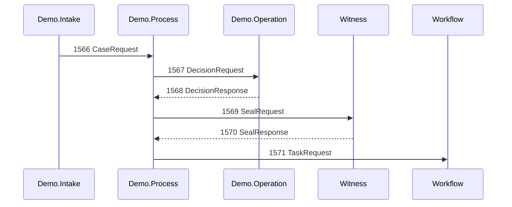

# Native LLM traceability, DPI-I-689

Proof Before Pay addresses [DPI-I-689](https://ideas.intersystems.com/ideas/DPI-I-689), “Use InterSystems Interoperability as a Traceability tool for GenAI LLM pipelines”. The Ideas Portal showed Community Opportunity status on 3 November 2026. The organizer clarified on 2 November in the [bonus post](https://community.intersystems.com/post/technology-bonuses-intersystems-programming-contest-ai-agents-interoperability-workflows) that Vector Search is not mandatory for this idea and multiple entries may implement it. No points are claimed as awarded.

## What the application actually records

- `pbp.Service.Intake` starts `pbp.Process.Decide`; the case stores the native production session id (`cls/pbp/Data/Case.cls`).
- A live proposal is a queued `pbp.Msg.DecisionRequest` to `pbp.Operation.Agent`, which uses the native `EnsLib.AI.Agent.OutboundAdapter` and `%AI.Agent` session.
- `pbp.Msg.DecisionResponse` carries provider/model, mode, prompt/completion tokens, duration, estimated micro-USD and actual tool outputs. `pbp.Process.Decide` persists this response and passes its guarded decision to Witness before review or effect.
- The five tool calls retain arguments and returned observations, constrained to the current case by authorization/audit policies. Missing evidence is sealed separately. The case API and time-machine view retain the production session id.
- The original private agent permits one corrective chat after an invalid reply. The dedicated Demo operation overrides this to zero; session1566 used only normal tool/decision protocol turns, without JSON repair or retry.

The [historical live integration report](validation/gemini-direct-smoke.json) records a real native Gemini decision: 2,557 prompt and 340 completion tokens, five tools, 4,995ms and a tariff estimate of US$0.00319275. This was a one-case integration smoke, not a model comparison or a new live demo. The [recorded video example](validation/native-recorded-demo42.json) made zero model calls; zero tokens in replay do not represent free live inference.

## Reproduce the inspection in your dedicated local instance

1. Install with the [English README](../README.md#judge-path) and vendor-licensed AI Hub build154. Preserve prior cases and receipts. No reset is necessary.
2. In the application, choose a retained case and open **Session details**. Read its `session_id` from the case/time-machine response. The running public viewer is consultation-only and does not grant the IRIS Management Portal to strangers.
3. In the private Management Portal, open **Interoperability → View → Messages**, select the session matching that id, then open **Visual Trace**. Follow Intake → Decide → Agent (or Replay) → Witness → Workflow → TestLedger.
4. Inspect the request and response bodies. For a retained live case, compare mode/model, tokens, elapsed time and the five returned tool observations with the case's sealed record. For recorded fixtures, expect `recorded`, zero usage and no provider call.
5. Compare the sealed decision commitment and review/permit/receipt chronology. A pending/rejected case has no effect; never approve it merely to display a trace.

On 3 November, a fresh read-only capture of the retained **recorded** session1494
showed all eleven native messages from Intake through Replay, Witness, Workflow and
TestLedger. The session itself dates from 28 October; opening it made no new model
call, submitted no case and approved no effect. See the [capture report](validation/native-VisualTrace-20261103.json)
and [native diagram](screens/native-visual-trace-recorded-1494.jpg). It is a native
IRIS screen, not an application-drawn imitation.

This screenshot demonstrates the recorded workflow, including its two seal steps
and authenticated Workflow chronology. It does not show a fresh live AI Hub call.
The separate historical live integration report above contains the model/tool and
usage evidence. The separate session1566 evidence below now provides a fresh LIVE native-header trace; it is not a new Management Portal screenshot.
No bonus award is assumed. The operator used a private local tunnel and a temporary
read-only trace role; its assignment and header SELECT privilege were removed after
capture, and the original roles were verified restored. Judges are not given the
Management Portal. Run a new model case only through explicitly bounded, privately
configured admission.

## Relation to Langfuse

Langfuse provides specialized cross-application LLM observability and evaluation. This application uses the already-native IRIS message session to correlate a proposal with read-only observations, Workflow review and the synthetic effect. It does not implement Langfuse's full analytics/evaluation surface, claim to replace it, or show a measured comparative advantage. Local commitments detect changes to record copies; privileged database rewrites and independent notarization remain outside the current protection.

## First valid cited LIVE session1566, 5 November

[The qualification record](validation/live-gemini35lite-1566-20261105.json) and
[read-only persisted native headers](validation/live-session1566-native-headers.json)
identify a new VPS execution using Gemini3.5Flash-Lite. The five observed tool
outputs equal the intact sealed record. GetStorePolicy used local FastEmbed,
%AI.RAG and IRIS Vector Search, returning three verified policy passages; the
valid proposal cites an actual returned chunk. Three normal HTTP200 turns ended
with complete JSON. No retry, JSON repair, permit, receipt or effect occurred.

The persisted session routes were:

This diagram transcribes the stored native headers; it is not an IRIS Visual Trace
UI screenshot. The case waits for human review. The linked record separates native
SDK visible-token estimates from the gateway's conservative output accounting.
Retained viewing/export makes no new model call. No quality ranking, full Langfuse
replacement, independent notarization or bonus award is inferred.

The [authenticated public-viewer browser check](validation/live1566-viewer-browser-20261105.json)
opened the retained1566 case and showed five tools, its real policy citation, intact
seal, pending human review and no permit/effect. The [viewer screenshot](screens/live1566-public-viewer-20261105.jpg)
is an application screen, not the IRIS Management Portal. This automated inspection
reused existing access, made no model call and confirmed that paused fresh admission
has inline status and a disabled Run button.
